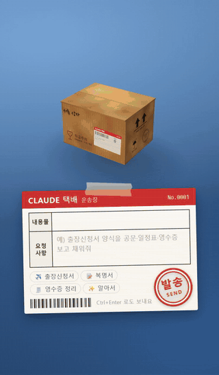
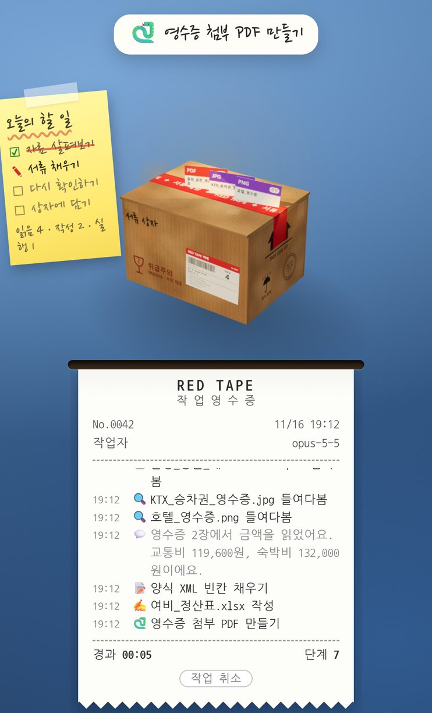
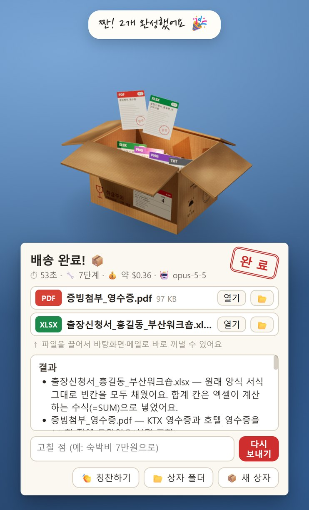

# 🟥 Red Tape

**서류는 상자에 넣고, 쾅.**
바탕화면에 떠 있는 작은 택배상자 앱입니다. 영어로 *red tape*는 번거로운 행정 절차를 뜻하죠. 그 서류들을 **빨간 테이프로 봉인하는 상자**에 맡기세요.

양식과 영수증·공문 같은 증빙 파일을 상자에 끌어다 넣고, 운송장에 요청을 적은 뒤 **발송** 도장을 누르면,
이 PC에 로그인된 **Claude Code**가 상자 안에서 서류를 채워 결과물을 다시 상자에 담아 줍니다.

출장신청서, 출장 복명서, 영수증 정산처럼 "양식 + 자료 → 채운 서류" 작업용으로 만들었어요.

> Anthropic과 관계없는 **비공식 개인 오픈소스 프로젝트**입니다. Claude는 Anthropic의 상표예요.
> *Red Tape is a desktop widget (Windows/macOS) that seals your paperwork — the red tape — in a cardboard box and hands it to your locally installed Claude Code. Unofficial, not affiliated with Anthropic.*

<p align="center">
  
</p>

**소개 페이지:** https://mingjaam.github.io/redtape-box/ — 실제 앱 화면을 브라우저에서 데모로 만져 볼 수 있어요.

## 내려받기

[GitHub Releases](https://github.com/Mingjaam/redtape-box/releases/latest)에서 받으세요.

| 운영체제 | 파일 | 처음 실행할 때 |
|---|---|---|
| Windows 10/11 | `RedTape-Setup.exe` (설치) 또는 `RedTape-Portable.exe` (무설치) | "Windows의 PC 보호" 창이 뜨면 **추가 정보 → 실행** |
| macOS 12+ (Apple Silicon·Intel 공용) | `RedTape-mac.dmg` | 응용 프로그램 폴더로 옮긴 뒤 열고, 막히면 **시스템 설정 → 개인정보 보호 및 보안 → 그래도 열기** |

코드 서명 인증서가 없는 개인 프로젝트라서 처음 한 번은 경고가 나옵니다.
macOS에서 "손상되었기 때문에 열 수 없습니다"라고 나오면 터미널에서 한 번 실행하세요:

```bash
xattr -cr "/Applications/Red Tape.app"
```

맥에서는 Dock 아이콘 없이 **메뉴 막대 아이콘**과 바탕화면의 상자로만 보여요. 종료는 상자 우클릭 → 종료, 또는 메뉴 막대 아이콘에서.

## 필요한 것

- **[Claude Code](https://claude.com/claude-code)** — 설치한 뒤 터미널에서 `claude`를 한 번 실행해 로그인해 두세요. 상자는 그 로그인을 그대로 씁니다.
  - 찾지 못하면 상자 우클릭 → 작업자 설정 → **Claude 연결 확인**으로 확인하고, 설정 파일의 `claudePath`에 경로를 적어 주세요.
- **Python** (권장) — Claude가 `openpyxl`, `python-docx` 등으로 서식을 채웁니다. 필요한 패키지는 Claude가 `pip install --user`로 설치해요.
- `.hwp`(바이너리 한글 문서)는 **Windows + 한컴오피스**가 있을 때 한글 프로그램을 자동화해 채웁니다. 그 외 환경에서는 `.hwpx` 또는 `.docx`+PDF로 대신 만들어요. `.hwpx`는 어디서나 됩니다.

## 동작 흐름

| 단계 | 화면 |
|---|---|
| 대기 | 둥실 떠 있는 골판지 상자 + 아래 운송장(요청 사항, 예시 문구 버튼, 발송 도장) |
| 파일 넣기 | 덮개가 열리며 펄럭 → 파일이 카드로 떨어져 꽂힘 (썸네일, 확장자 색, 양식/증빙/자료 표시) |
| 발송 | 도장 쾅 → 운송장이 상자로 빨려 들어감 → 덮개 닫힘 → 빨간 테이프 봉인 |
| 작업 중 | 상자 틈으로 빛이 새고 덜컹 · 말풍선에 지금 하는 일 · 아래로 **작업 영수증** · 옆에 **할 일 포스트잇** |
| 완료 | 빨간 테이프가 찢기고 완성 서류 카드가 떠오름 · **결과 카드**(열기 / 폴더 / 끌어서 꺼내기, 요약, 확인 필요 항목) |
| 수정 요청 | 결과 카드에 고칠 점을 적고 "다시 보내기" → 같은 상자·같은 대화에서 이어서 작업 (`claude --resume`) |

<p align="center">
  
  
</p>

## 조작

- **파일 넣기**: 상자에 드래그&드롭 (폴더도 가능), 또는 상자 더블클릭 → 파일 선택
- **역할 바꾸기**: 운송장의 `양식/증빙/자료` 배지 클릭 (Claude에게 힌트로 전달)
- **상자 옮기기**: 상자를 잡고 끌기 · **메뉴**: 우클릭
- **보내기**: 발송 도장 또는 `Ctrl+Enter` (맥 `⌘+Enter`)
- **결과 꺼내기**: 결과 카드의 파일 줄을 바탕화면·메일 창으로 끌어다 놓기, 떠 있는 카드 클릭 = 열기
- 상자 바깥 투명한 곳은 클릭이 바탕화면으로 통과합니다 (우클릭 메뉴에서 끌 수 있음)
- 우클릭 → **🎬 데모 재생**: Claude를 부르지 않고 연출만 보기

## ⚠️ 취급주의 — 권한과 개인정보

- **기본 권한은 `bypassPermissions`** 입니다. 서식을 채우려면 Claude가 파이썬을 실행하고 파일을 만들어야 해서, 매번 허락을 묻지 않아요. 첫 작업 전에 한 번 안내 창이 뜹니다.
  - 작업 위치는 작업 폴더지만 **운영체제 수준의 격리(샌드박스)는 아닙니다.** 파이썬은 내 계정 권한으로 무엇이든 할 수 있어요.
  - 모르는 사람이 보낸 문서에는 Claude를 속이려는 숨은 지시(프롬프트 인젝션)가 들어 있을 수 있어요. 그런 파일을 넣을 땐 우클릭 → 작업자 설정 → 권한을 **파일 편집만 허용(`acceptEdits`)**으로 바꾸세요. 대신 명령 실행이 막혀 일부 서식은 못 채울 수 있습니다.
- 넣은 파일의 **내용은 Claude Code를 통해 Anthropic으로 전송**되어 처리됩니다. 회사 보안 규정을 확인하세요.
- 넣은 파일의 사본과 결과물은 `문서/RedTape/` 아래에 계속 남습니다. 필요 없으면 직접 지워 주세요.
- **비용**: 앱은 무료이고, 작업은 내 Claude 요금제(또는 API 사용량)에서 쓰입니다. 결과 카드에 걸린 시간과 사용량(API 환산)이 표시돼요. 예시로 출장신청서 한 건이 약 $0.36이었습니다.
- 채운 값은 꼭 직접 확인하세요. Claude는 모르는 값을 「확인 필요」로 남기도록 지시받지만, 틀릴 수 있어요.

## 작업 상자(폴더)

매 작업은 `문서/RedTape/<날짜_시각>_<번호>_<요청>/` 에 만들어집니다.

```
inputs/    넣은 파일의 사본 (원본은 건드리지 않음)
outputs/   결과물
work/      Claude 의 중간 스크립트
prompt.md  Claude 에게 보낸 지시문
job.json   기록 (세션 ID, 결과 요약, 비용)
```

## 설정 (우클릭 → 작업자 설정)

| 항목 | 기본값 | 설명 |
|---|---|---|
| 모델 | Claude Code 기본 | opus / sonnet / haiku |
| 노력 수준 | 기본 | `--effort` |
| 권한 | `bypassPermissions` | 위 "취급주의" 참고. `acceptEdits`는 명령 실행이 막힘 |
| 항상 위 / 클릭 통과 / 효과음 | 켬 | |

설정 파일: Windows `%APPDATA%\Red Tape\config.json`, macOS `~/Library/Application Support/Red Tape/config.json`.
`claudePath`(claude 실행 파일 경로), `jobsDir`(작업 폴더 위치)를 직접 바꿀 수 있어요.

## 문제가 생기면

| 증상 | 해결 |
|---|---|
| "claude 명령을 찾지 못했어요" | 터미널에서 `claude --version`이 되는지 확인 → 설정 파일 `claudePath`에 전체 경로 입력 |
| 파일을 끌어다 놓았는데 안 들어가요 | 상자 우클릭 → **빈 곳 클릭 통과** 끄기 |
| 서식이 깨지거나 일부만 채워져요 | 결과 카드에 고칠 점을 적어 다시 보내기. Python 설치 여부 확인 |
| 상자가 화면 밖으로 사라졌어요 | 트레이(메뉴 막대) 아이콘 → 위치 초기화 |

버그나 제안은 [이슈](https://github.com/Mingjaam/redtape-box/issues)로 남겨 주세요.

## 직접 빌드하기

Node.js 22 이상이 필요합니다.

```bash
npm install          # postinstall 이 three.js·폰트를 renderer/vendor 로 복사
npm start            # 개발 실행

npm run dist:win     # Windows 설치 파일 + 무설치판 → dist/
npm run dist:mac     # macOS dmg/zip (맥에서 실행, ad-hoc 서명)
npm run site         # 소개 사이트 → _site/
```

`v*` 태그를 올리면 GitHub Actions가 Windows·macOS 설치 파일을 만들어 Release에 붙이고, `main`에 사이트가 바뀌면 GitHub Pages로 배포합니다.

### macOS 서명·공증 (관리자용)

저장소 **Settings → Secrets and variables → Actions** 에 아래 값이 있으면 CI가 Developer ID로 서명하고 Apple 공증까지 받습니다. 없으면 ad-hoc 서명으로 빌드돼요.

| Secret | 내용 |
|---|---|
| `MAC_CERT_P12_BASE64` | Developer ID Application 인증서 `.p12` 파일을 base64로 |
| `MAC_CERT_PASSWORD` | 그 `.p12` 비밀번호 |
| `APPLE_API_KEY_P8` | App Store Connect API 키 `.p8` 파일 내용 |
| `APPLE_API_KEY_ID` | API 키의 Key ID |
| `APPLE_API_ISSUER` | Issuer ID |

맥에서 직접 빌드할 때는 `npm run dist:mac`(키체인의 인증서로 서명) 또는 `npm run dist:mac:adhoc`(인증서 없이).

### 구조

```
main.js              창(투명·테두리 없음·항상 위), 트레이, 메뉴, IPC, 작업 실행
preload.js           렌더러에 노출하는 최소 API
src/claude-runner.js claude -p --output-format stream-json 실행·파싱, 취소(프로세스 트리 종료)
src/job.js           작업 폴더, 입력 복사, 지시문(prompt) 작성, 결과 수집
src/config.js        설정 파일 읽기/쓰기 (값 검증)
renderer/box3d.js    three.js 상자: 플랩 스프링, 카드 낙하, 테이프, 빛, 파티클
renderer/textures.js 골판지·인쇄·라벨·카드 텍스처를 캔버스로 직접 그림 (외부 이미지 없음)
renderer/app.js      상태 기계 + 운송장/영수증/포스트잇/결과 카드 UI (브라우저에서는 데모 모드)
renderer/sfx.js      WebAudio 합성 효과음
renderer/activity.js 도구 호출 → 재밌는 한 줄 설명
site/                소개 페이지 (GitHub Pages)
```

개발용 스크린샷: `npx electron . --shot --shot-dir=shots --shots=idle,loaded,working,done`

## 라이선스

[MIT](LICENSE). 함께 배포되는 글꼴 [나눔손글씨 펜](https://fonts.google.com/specimen/Nanum+Pen+Script)·[나눔고딕코딩](https://fonts.google.com/specimen/Nanum+Gothic+Coding)은 SIL Open Font License 1.1, [three.js](https://threejs.org)는 MIT 라이선스를 따릅니다.
